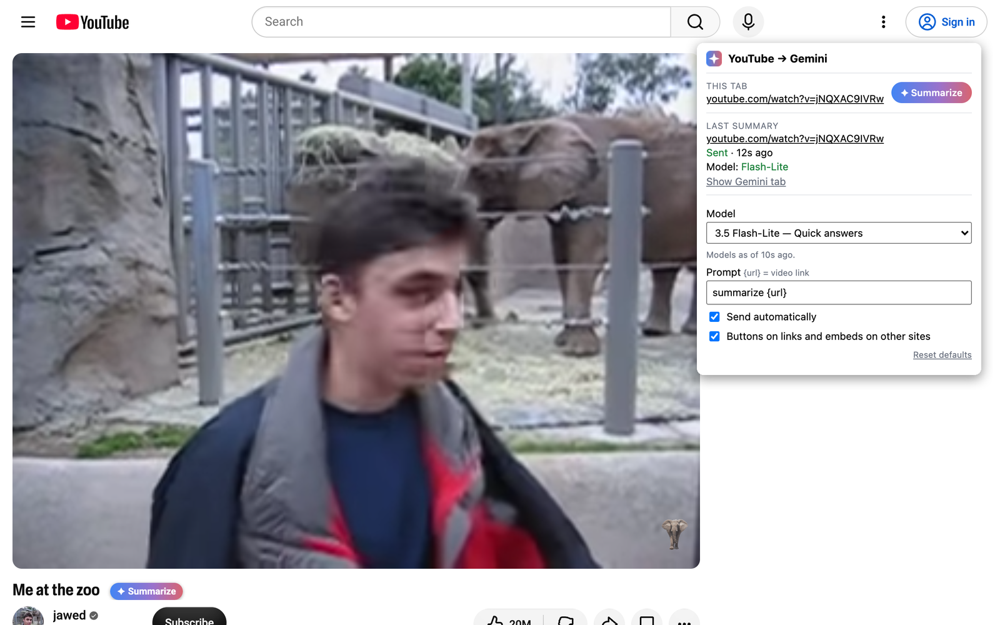

# YouTube → Gemini Summarize

A browser extension for Chrome, Brave, Edge and Firefox that adds a **✦ Summarize** button to YouTube videos.
Clicking it opens a new Gemini tab, starts a fresh chat and sends
`summarize https://www.youtube.com/watch?v=<id>` for you.



## Where the button appears

- **Watch pages**: inline after the video title (it wraps with long titles).
- **Thumbnails** on home, search, channels and playlists: a labelled pill in the top-left corner.
- **Small thumbnails** (watch-page sidebar, Shorts): a round ✦ icon in the bottom-left corner, which stays
  visible while YouTube autoplays the hover preview.
- **Shorts pages**: top-right.
- **Other websites**: inside embedded YouTube players, above YouTube links when you hover over them, and on
  `lite-youtube` embeds.
- **Right-click** any YouTube link → *Summarize video with Gemini*.

## Toolbar popup

Click the extension's toolbar icon to:

- summarize the video in the current tab (or the first YouTube embed on the page);
- see the last summary's status: sent or failed, the model actually used, and a link back to the Gemini tab;
- change settings, which save immediately:
  - **Model** (default **Flash-Lite**), chosen from the models Gemini offers. Models that need sign-in or a paid
    plan are marked and fall back to Gemini's default.
  - **Prompt** template (`{url}` is replaced by the video link).
  - **Send automatically**, or just type the prompt and let you send it.
  - **Buttons on other sites** on or off.

## Install

### Chrome, Brave, Edge and other Chromium browsers

1. Download this repository (**Code → Download ZIP**, then unzip) or `git clone` it.
2. Open `chrome://extensions` (`brave://extensions`, `edge://extensions`).
3. Turn on **Developer mode**.
4. Click **Load unpacked** and select the repository folder (the one containing `manifest.json`).
5. Optionally pin the extension to the toolbar.

To update, pull or re-download and click the reload icon on the extension's card.

### Firefox (140 or newer)

1. Open `about:debugging#/runtime/this-firefox`.
2. Click **Load Temporary Add-on…** and choose `manifest.json` in the repository folder.

Temporary add-ons are removed when Firefox restarts. For a permanent install, build the zip (below) and sign it
as an unlisted add-on on [addons.mozilla.org](https://addons.mozilla.org/developers/). If the buttons don't
appear, allow the extension's site access in `about:addons` → the extension → **Permissions**.

## How it works

The background script opens `gemini.google.com/app` next to the current tab and holds the prompt for that tab
only, so no other page can trigger a prompt. `gemini.js` waits for Gemini's prompt box, chooses the configured
model in Gemini's model picker, types the prompt, checks it stuck, sends it, and only then clears it, retrying if
Gemini re-renders while loading. Nothing is sent anywhere except to Gemini in your own browser session, and the
extension collects no data.

## Development

```sh
npm install
npm test                 # Playwright Chromium end-to-end: YouTube, other sites, embeds, Gemini, popup
npm run test:firefox     # Selenium with real Firefox
npm run lint             # web-ext lint
npm run build            # dist/*.zip for stores / signing
node test/screenshots.mjs  # raw shots for docs/screenshot.png (recommendations hidden)
```

YouTube and Gemini change their pages often; the selectors live in `youtube.js` and `gemini.js`.

## License

[MIT](LICENSE)
